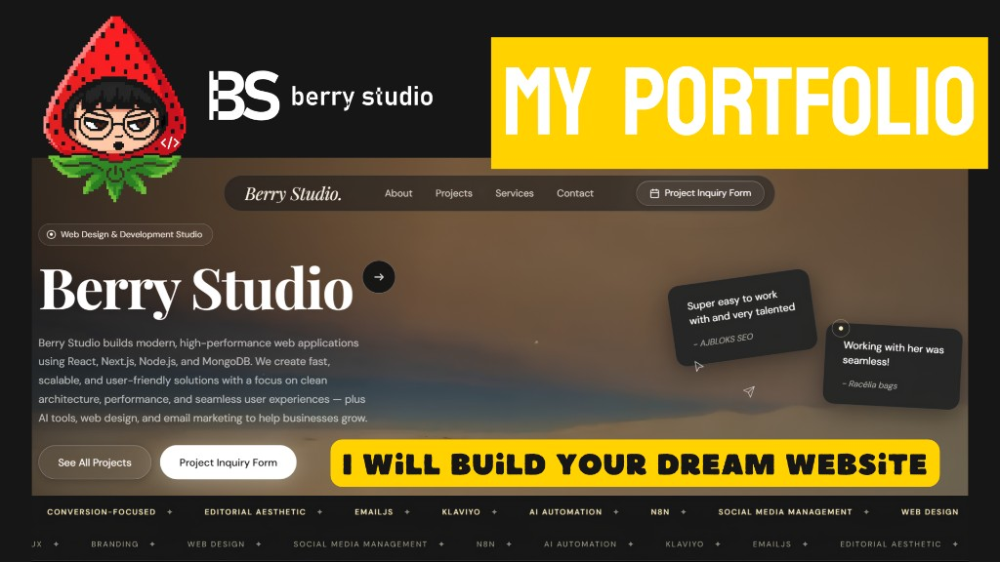

<p align="center">
  
</p>

<h1 align="center">Berry Studio</h1>

<p align="center">
  <strong>Clean design. Fast code. Real results.</strong><br />
  A conversion-focused web studio portfolio — React, motion, and editorial polish.
</p>

<p align="center">
  <a href="https://portfolio-m38t.vercel.app"></a>
  &nbsp;
  <a href="https://tally.so/r/2EOglL"></a>
</p>

---

## What this is

The public face of **Berry Studio** — a bilingual (EN / FR) portfolio that shows how we build: modern storefronts, brand sites, and performance-minded web apps. Less brochure, more proof.

Built with **React 19**, **Vite**, **Framer Motion**, and **Tailwind** — shipped on Vercel.

---

## Highlights

| | |
| :--- | :--- |
| **Brand-first UI** | Playfair wordmark, full-bleed hero video, intentional motion |
| **Work that ships** | RACÈLIA, WELLNEST, AjBloks, Badee Beauty, and more |
| **Bilingual** | English & French content throughout |
| **Inquiry-ready** | Tally project form + contact sheet integration |
| **Agent-friendly** | `llms.txt`, ARD, and OpenAPI under `public/` |

---

## Stack

```text
React 19  ·  Vite 8  ·  React Router  ·  Framer Motion
Tailwind CSS  ·  Cloudinary media  ·  Vercel
```

Also in the mix across client work: Next.js, Node, MongoDB, EmailJS, Klaviyo, n8n, and AI automation.

---

## Run locally

```bash
npm install
npm run dev
```

| Script | What it does |
| :--- | :--- |
| `npm run dev` | Local Vite server |
| `npm run build` | Production build → `dist/` |
| `npm run preview` | Preview the production build |

Optional: set `VITE_SITE_URL` for Open Graph / SEO absolute URLs.

---

## Project map

```text
src/
  components/   # Hero, nav, cards, motion, SEO
  pages/        # Home, About, Projects, Services, Contact, Project detail
  data/         # Brand copy, projects, SEO helpers
  i18n/         # Language context + localized content
public/         # Static assets, llms.txt, agent catalog
```

---

## Selected work

- **RACÈLIA** — luxury e-commerce + admin
- **WELLNEST** — bilingual wellness platform (FR / AR)
- **AjBloks** — custom toy storefront + loyalty + wholesale
- **Badee Beauty** — storefront, admin, automated email
- **Floréa** — Paris florist, Next.js, mobile-first

---

## Say hello

Ready to build something that looks sharp and converts?

**[Open the Project Inquiry Form →](https://tally.so/r/2EOglL)**

Or reach out: [buildwith.khadidja@gmail.com](mailto:buildwith.khadidja@gmail.com) · [LinkedIn](https://www.linkedin.com/in/khadidja-hassani)

---

<p align="center">
  <sub>Berry Studio · I will build your dream website.</sub>
</p>
